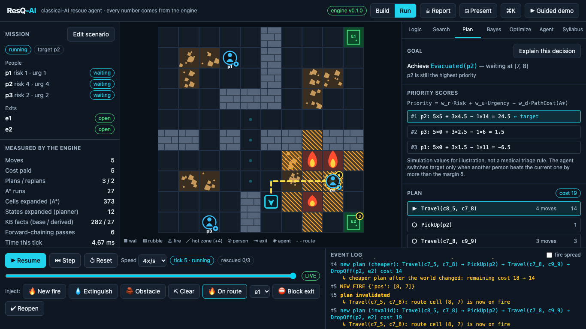
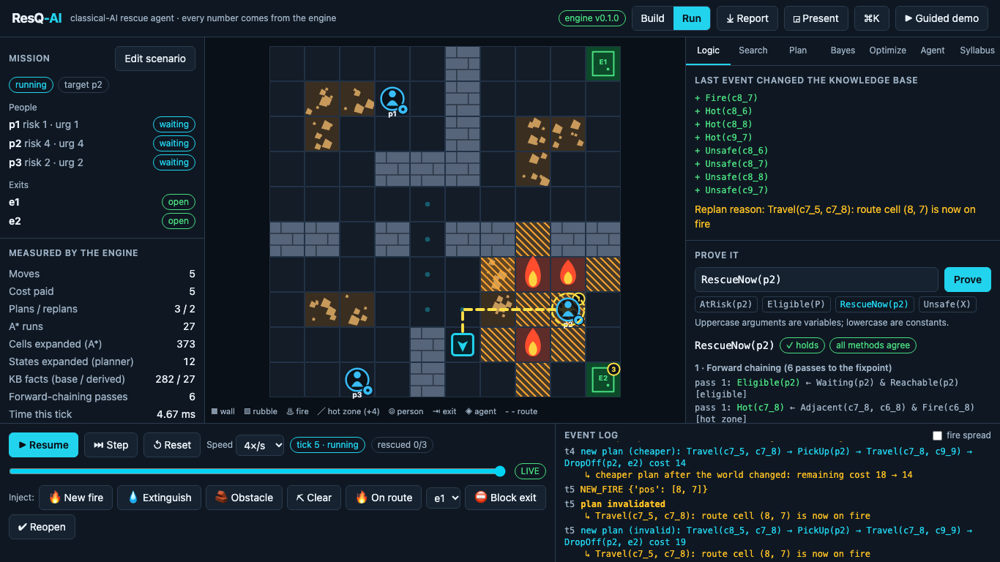
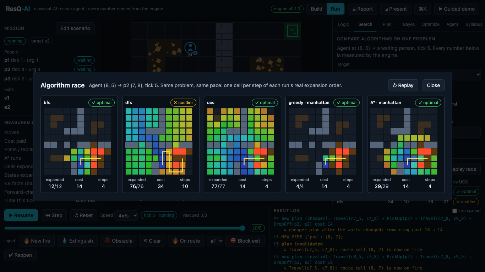
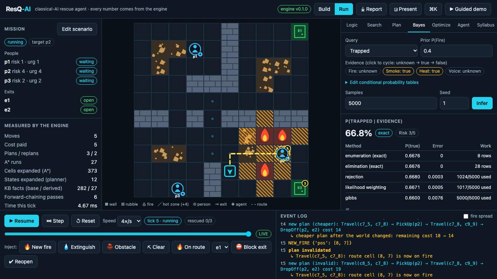
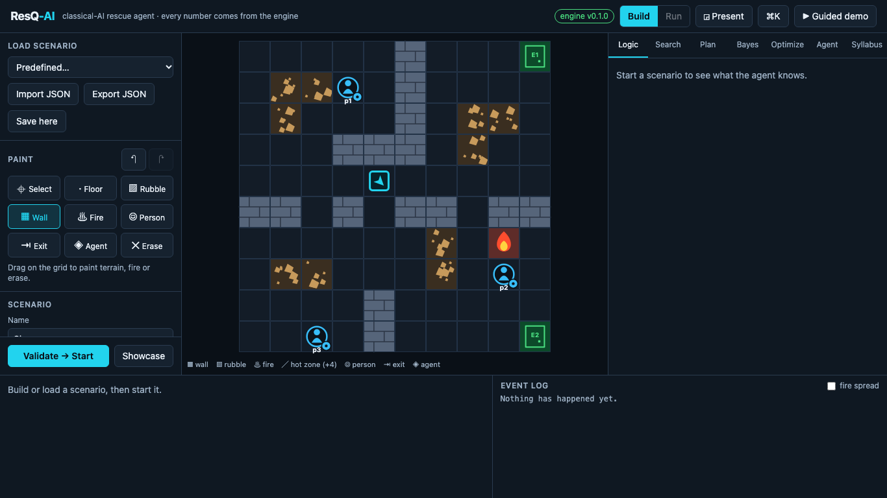

# ResQ-AI

A rescue simulator built to show the whole of a classical AI course (BCSE306L, Russell &
Norvig, *AIMA* 3e) working inside one agent. An agent on a grid rescues people from a
spreading fire. It reasons with a knowledge base, estimates danger with a Bayesian network,
chooses whom to save with a utility function, searches for routes, plans with STRIPS, and
replans when the world changes. Every route, fact, plan, probability and metric on screen comes
from the engine, and every decision can be traced back to the computation that produced it.



## Quickstart

Needs [uv](https://docs.astral.sh/uv/), [pnpm](https://pnpm.io/) and Node 20+. Python 3.12 is
fetched by uv.

```bash
make install     # Python and web dependencies
make dev         # API on localhost:8000 and the app on localhost:5173
```

Open <http://localhost:5173> and press **▶ Guided demo**. It runs the 17-step walkthrough
against the real engine.

No browser? `make demo` runs the whole workflow in the terminal, offline.

## What it covers

| Module | In the app |
|---|---|
| 1 Agents | PEAS, environment properties derived from the scenario, benchmark of reflex vs goal-based vs utility-based agents |
| 2 Search | BFS, DFS, DLS, IDDFS, UCS, Greedy, A*, weighted A* on one problem; Algorithm Race; heuristic lab (admissibility and consistency checked on every cell) |
| 3 Local and adversarial search | Rescue-order optimiser (hill climbing, simulated annealing, genetic algorithm vs greedy vs exhaustive); fire as an opponent with minimax and alpha-beta |
| 4 Logic | Horn-clause KB with unification and provenance; forward chaining; backward chaining with proof trees; resolution refutation ("Prove it") |
| 5 Uncertainty | Sensor Bayesian network; enumeration, variable elimination, rejection sampling, likelihood weighting, Gibbs; the posterior sets each person's risk |
| 6 Planning | STRIPS domain; forward and regression planners with equal cost; planning graph with mutexes; HTN decomposition; execution monitoring and replanning |
| 7 Perception, language | Out of scope. Sensors are simulated inputs to the Bayesian network |
| 8 Ethics | [docs/ETHICS.md](docs/ETHICS.md) |

The full map from module to code to UI to tests is in [docs/SYLLABUS_MAP.md](docs/SYLLABUS_MAP.md).

| | |
|---|---|
|  |  |
| Forward chaining, backward chaining and resolution answering the same goal | Eight search algorithms replaying their real expansion order side by side |
|  |  |
| Exact posterior and sampling error converging to it | Scenario builder with inline validation by the engine |

## Commands

| Command | What it does |
|---|---|
| `make dev` | API and web app together; Ctrl-C stops both |
| `make check` | The full gate: regenerate API types, lint, type-check, 285 Python tests, 51 web tests, production build, 12 browser tests |
| `make demo` | Headless run of the complete workflow (`make demo ARGS="--scenario triage_dilemma"`) |
| `make bench` | Seeded agent-type benchmark; writes [docs/BENCHMARK.md](docs/BENCHMARK.md) |
| `make e2e` | Browser tests only |

In the app: **space** plays or pauses, **→** steps, **←** scrubs back, **p** toggles
presentation mode, **Ctrl/Cmd+K** opens the command palette, and **⤓ Report** downloads the
run report (JSON and a printable page).

## How it is built

- **Engine** (`engine/resq/`): pure Python 3.12, standard library only. Every AI function
  returns `(result, trace)`. Runs are deterministic: a scenario, its seed and the log of user
  events rebuild any tick exactly, which the timeline scrubber relies on.
- **API** (`api/`): FastAPI and Pydantic v2, a thin layer that copies engine results. One
  WebSocket streams ticks during autoplay.
- **Web** (`web/`): React 19, TypeScript (strict), Tailwind v4, Zustand, TanStack Query, Canvas
  2D for the grid, Recharts for charts. API types are generated from the OpenAPI schema, so the
  two sides cannot drift.

Details: [docs/ARCHITECTURE.md](docs/ARCHITECTURE.md). Viva preparation:
[docs/VIVA_QA.md](docs/VIVA_QA.md). Presenting: [docs/DEMO_SCRIPT.md](docs/DEMO_SCRIPT.md).

## Limitations

- **Simulation only.** No real fire, sensors or people. All risks, urgencies, costs and
  probabilities are made-up values chosen for teaching. This is not a triage system.
- **"Optimal" means optimal for the stated cost model on this grid**, checked against
  uniform-cost search. It never means best for the people involved.
- **One agent carrying one person at a time.** Fog of war, multi-agent coordination and D* Lite
  (the brief's optional extras) are not built.
- **Fire is either a seeded random process or a worst-case opponent**, not a physical model.

See [docs/ETHICS.md](docs/ETHICS.md) for what that means for trusting its decisions.
